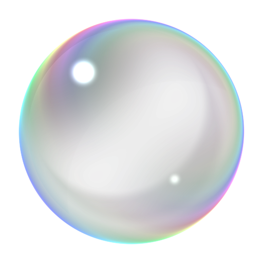
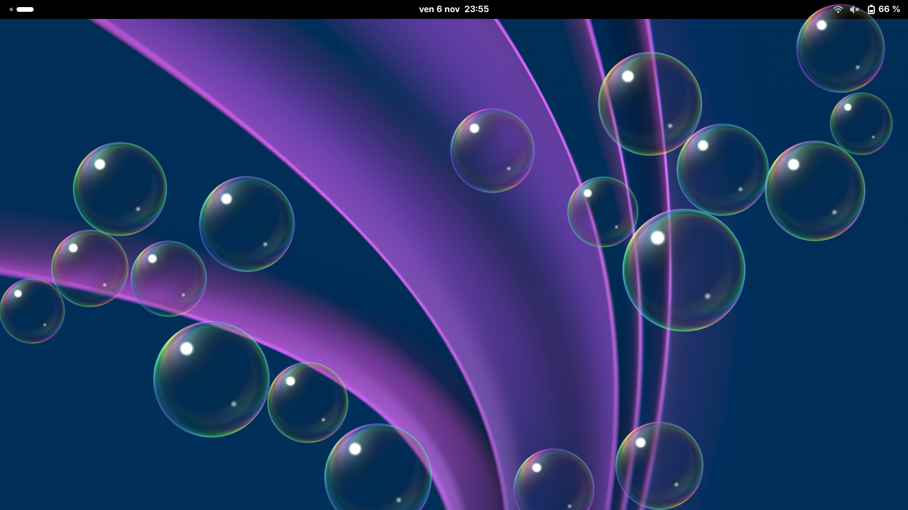
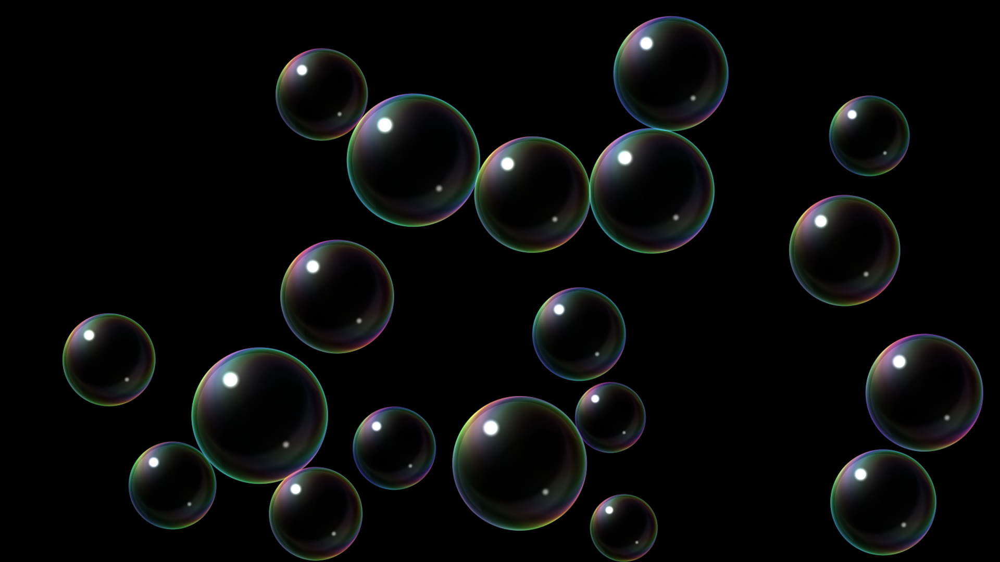

<p align="center">
  
</p>

<h1 align="center">GNOME Bubbles Screensaver</h1>

<p align="center">
  
  &nbsp;
  
</p>

https://github.com/user-attachments/assets/12471d03-33a9-4323-9848-c24655d532ca

A GNOME screensaver inspired by the Windows 7 bubbles screensaver, written with GNOME's native technologies (GJS and Clutter). The extension is configurable: number of bubbles, depth layers, style and color, size, speed, timing, and more.

The screensaver stays hidden while an application holds an idle inhibitor (video playback, screen sharing, a game, …). System suspend is left to GNOME's Power settings.

## Installation

```bash
./install.sh
```

Log out and back in once, then enable **Bubbles Screensaver** in the Extensions app and open its preferences. Requires GNOME Shell 51.

## License

GPL-3.0-or-later. See [LICENSE](LICENSE).
